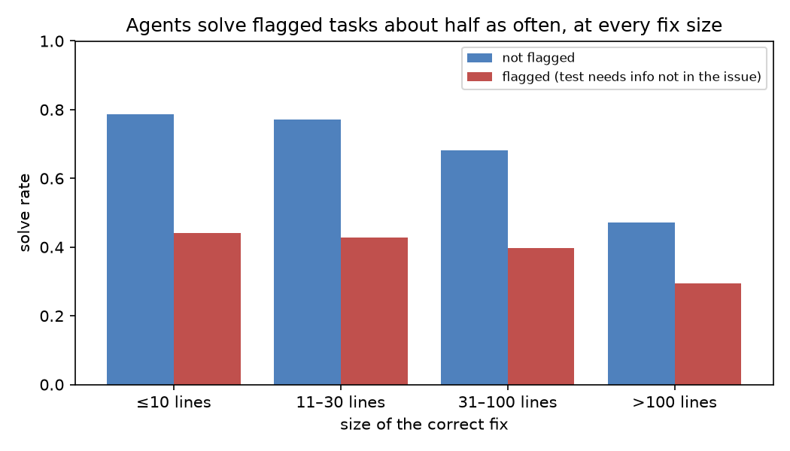
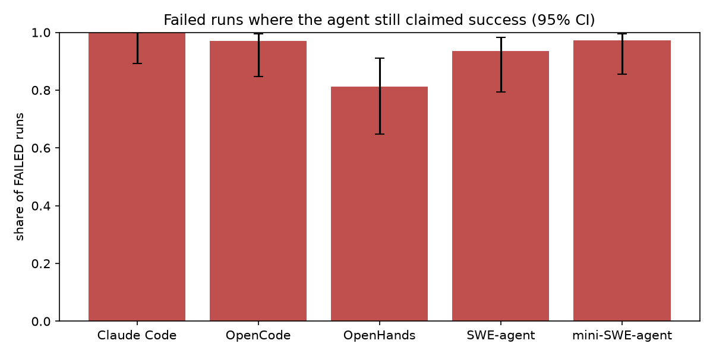
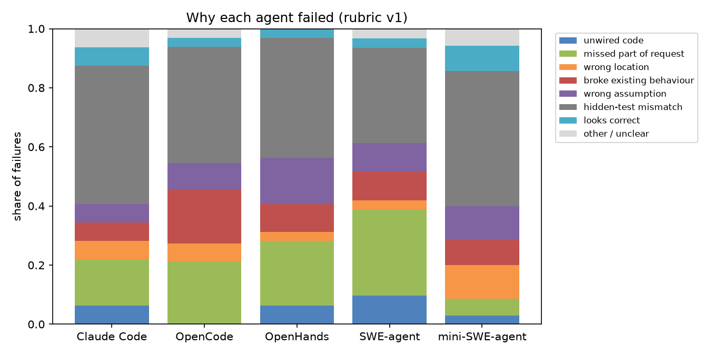

# traces-eval

**Why do coding agents fail, do they know they failed, and how often is the failure the test's fault?**

An error analysis of 300 real coding-agent runs (5 agents, same model, same tasks), a rule-based fairness check scaled to all 20,181 tasks of the underlying training dataset, and a controlled Harbor experiment.

## Headline results
- **Agents almost never admit failure.** In **94%** of failed runs (153/163, 95% CI 89–97%) the agent's final message still claimed the fix worked, and in 89% it claimed to have verified it. Solved runs claimed success 93% of the time, so a success claim says almost nothing about the outcome.
- **Many failures are the test's fault.** In the 163 analysed failures, **41%** had hidden tests that required names, exact values or files the issue never stated (*hidden-test mismatch*).
- **At dataset scale: 24% of tasks, solved half as often.** A rule with no AI flags tasks whose hidden test needs a name or literal that the correct fix introduces and the issue never mentions. It flags **24.2% of all 20,181 Scale-SWE tasks**. Across 76,480 Open-SWE-Traces runs, flagged tasks are solved **35.5%** of the time vs **68.0%** for the rest, for every one of the five agents and at every size of fix (≤10-line fixes: 44.0% vs 78.7%). In a controlled Harbor experiment on a flagged task, adding one sentence with the missing detail took goose from **0/3 to 3/3**. See [`results/fairness_summary.md`](results/fairness_summary.md).
- **The real agent mistakes:** missed part of the request (18%), broke existing behaviour (10%), wrong assumption (10%), wrong location (6%), unwired code (5%).
- **Clean, clearly specified tasks are solved.** On Harbor tasks we built from those mistakes, all five agents (goose, pi, Prime Agent, mini-SWE-agent, OpenCode) passed every run (51/51), which matches METR's observation that clean tasks overestimate agents.





## Data
- [nvidia/Open-SWE-Traces](https://huggingface.co/datasets/nvidia/Open-SWE-Traces) v2.0 (CC BY 4.0), source `scale-swe`, reasoning effort `xhigh`.
- All five agents run the **same model** (Qwen3.8-Flash-Next), so differences come from the agent design: Claude Code, OpenCode, OpenHands, SWE-agent, mini-SWE-agent.
- Sample: 60 tasks attempted by all five agents, stratified by how many agents solved them (30 mixed, 20 none, 10 all) with a fixed seed → **300 runs, 163 failures**.

## Method (Half 1)
| Step | What | Script / output |
|---|---|---|
| Index | light columns of every run, read straight from Hugging Face | `scripts/build_index.py` |
| Sample | shared tasks, stratified, fixed seed | `scripts/pick_sample.py` |
| Fetch | only the sampled rows, verified (trajectory id, not truncated) | `scripts/locate.py`, `offsets.py`, `fetch_rows.py` |
| Viewer | local HTML page per run, incl. the model's thinking | `scripts/make_viewer.py` |
| False success | an AI judge labels each final message (claims success / hedged / admits failure), blind to the outcome | `scripts/judge_claims.py` → `results/claims.jsonl` |
| Failure notes | an AI drafts one note per failed run (sees the reference patch) | `scripts/draft_notes.py` → `results/notes_draft.jsonl` |
| Spot check | 15 notes checked against the issue text and both patches: 7 correct, 5 partly, 2 unsure, 1 partly wrong | `results/spotcheck.json` |
| Rubric | 8 failure types built from the notes (not from preset labels) | `rubric.md` |
| Two graders | grader A (Claude, all 163, from the notes) and grader B (AI, from raw evidence, 77 usable labels) | `results/labels_*` |
| Agreement | 69% exact, Cohen's kappa 0.57; 75% agree on "agent mistake vs task/grader problem" | `results/agreement.txt` |
| Report | counts with Wilson 95% intervals and charts | `scripts/report.py` → `results/summary.md` |

## Fairness check at dataset scale
`fairness/check.py` reads, for every task in [AweAI-Team/Scale-SWE](https://huggingface.co/datasets/AweAI-Team/Scale-SWE), the issue, the correct fix and the hidden test (`f2p_script`). It flags the task when the test uses a name (function, method, class, constant) or a literal that the fix newly introduces (test files in the fix are ignored) and that the issue does not mention. The per-task list with the missing names is in [`results/fair_tasks.csv`](results/fair_tasks.csv).

- Flagged: 4,874 of 20,181 tasks (24.2%).
- Solve rate on Open-SWE-Traces (scale-swe, xhigh): 35.5% flagged vs 68.0% not flagged; the gap holds per agent and per fix size.
- Validation against the Half 1 labels on 60 tasks is weak (53% agreement, precision 46%, recall 32%), so the rule is a coarse screen rather than a per-task verdict. It never flagged a task that all five agents solved.
- Scale-SWE has two graders per task: a generated test (`f2p_script`) and the real PR tests (`FAIL_TO_PASS`). They can disagree: for clusterscope the generated test accepts the agents' `to_unit` solution, while the PR tests require methods renamed to `get_mem_MB` / `get_mem_per_node_MB`, which the issue never mentions.

## Controlled experiment (Harbor)
To test the cause rather than the correlation, `tasks/proof-clusterscope-original` and `tasks/proof-clusterscope-clarified` use Scale-SWE's own Docker image and the strict PR tests. The only difference is one added sentence naming the renamed methods. Both versions pass the validity checks (reference fix scores 1, doing nothing scores 0).

Result (goose, free `nvidia/nemotron-3.5-super-vl:free`, 3 tries each):

| Version | goose | Hidden PR tests |
|---|---|---|
| original issue | **0/3** | 3 failed in every try |
| issue + one sentence naming the renamed methods | **3/3** | 3 passed in every try |

Same task, agent, model and tests; only the missing detail changed. On this task the failure is caused by the underspecified issue, not by the agent.

## Harbor tasks from the top mistakes (ceiling effect)
Three tasks, one per top agent-mistake type, each based on a real pattern from Half 1. Every task text states everything the hidden grader checks (lesson from the 41% hidden-test mismatch). Each task asks the agent to write `{"fixed": ..., "confidence": 0-100}` so false success can be measured live.

| Task | Trap | v2 (harder) |
|---|---|---|
| `hidden-items` | missed part: hide items in browse **and** search | search goes through a separate index that never says "unlisted" |
| `bot-labels` | broke behaviour: add `bot/` labels **and keep the old ones** | three modules check labels in three different ways |
| `runner-stats` | wrong assumption: the new record format changes field order | the order is only documented in the runner's changelog; a second module indexes records itself |

Validity checks for every task: the reference solution scores 1, doing nothing scores 0, and the tempting wrong fix scores 0.

Results (free `nvidia/nemotron-3.5-super-vl:free` via OpenRouter, 3 tries per cell):

| Agent | v1: hidden-items | v1: bot-labels | v1: runner-stats | v2 pilot (1 try each) |
|---|---|---|---|---|
| goose | 3/3 | 3/3 | 3/3 | 3/3 |
| pi | 3/3 | 3/3 | 3/3 | — |
| Prime Agent | 3/3 | 3/3 | 3/3 | — |
| mini-SWE-agent | 3/3 | 3/3 | 3/3 | 3/3 |
| OpenCode | 3/3 | 3/3 | 3/3 | — |

**All 45 v1 runs and all 6 v2 pilot runs passed, and every self-reported confidence (95–100%) matched the outcome.** These tasks therefore do not separate agents (a ceiling effect). What they do show: when a task is small or clearly specified, these agents avoid the traps that appear in Half 1, which points at scale and underspecified tasks as the main causes of the real failures.

Note: Half 2 uses a different model (Nemotron) from Half 1 (Qwen3.8), so compare patterns, not exact numbers.

## Limits
- One model per half, one sample of 60 tasks, synthetic Harbor tasks.
- The failure notes are AI drafts; the rubric labels come from one Claude pass plus an independent AI grader, and 15 notes were cross-checked by Claude (not by a human).
- "Hidden-test mismatch" is a judgement that the issue text does not state what the tests require; some of those tasks may still be solvable by inference.
- The fairness rule is lexical: it misses requirements that are not new names or literals, and it can flag details an agent could infer. The solve-rate gap is a correlation; the Harbor experiment covers one task.

## Run it
```bash
uv sync
uv run python scripts/build_index.py && uv run --with pandas python scripts/pick_sample.py
uv run python scripts/locate.py && uv run python scripts/offsets.py && uv run python scripts/fetch_rows.py
uv run python scripts/make_viewer.py            # open data/viewer/index.html
OPENROUTER_API_KEY=... PYTHONPATH=scripts uv run python scripts/judge_claims.py
uv run python scripts/report.py

# Fairness check (HF_TOKEN recommended for downloads)
uv run python fairness/fetch_scaleswe.py && uv run python fairness/check.py
uv run python fairness/validate.py && uv run python fairness/report.py

# Half 2 (needs Harbor): oracle/nop checks, then agents
./run_agents.sh goose
TASKS="hidden-items-v2 bot-labels-v2 runner-stats-v2" ./run_agents.sh goose
```

## Credits
Tasks: AweAI-Team/Scale-SWE (Hugging Face). Data: Ahmad, Ludwig, Majumdar, Ginsburg. *Open-SWE-Traces: Advancing Dual-Mode Multilingual Distillation for Software Engineering Agents.* Findings of EMNLP 2026. CC BY 4.0.

## License
Apache-2.0
